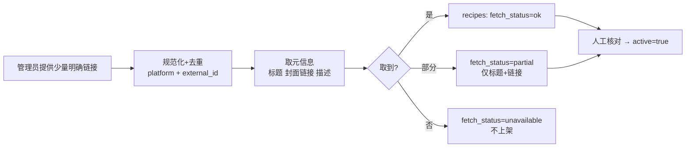
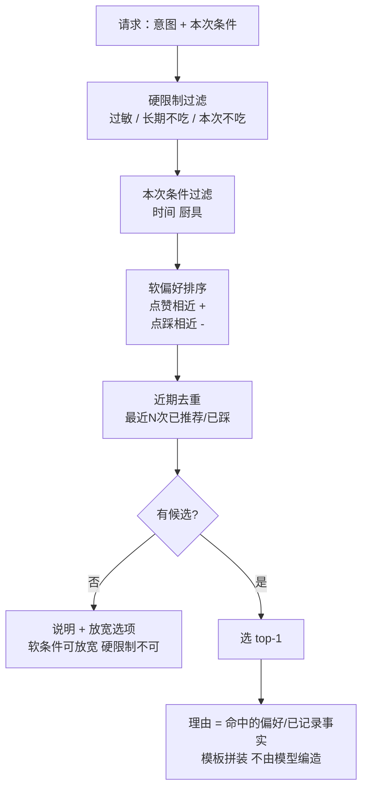

# PRD 03：指定来源的精选食谱、推荐与收藏

状态：草案 · **被 Q15 阻塞（没有指定 UP 主的真实链接）** · 依赖：ADR-007、ADR-008、PRD 04 · 对应 Patch §8、B08、B09

## 1. 背景与目标
用户常卡在"今天吃什么"。我们不做通用食谱库，只做**你指定的来源**里的精选内容，用小爪在对的时刻给出 1 个能做的选择，并学会"这个人喜欢什么"。
**目标**：把"想不出吃什么"变成 一句话 → 一张可信的卡片 → 看视频/换一个/收藏；并且推荐**可解释**、**尊重硬限制**。
**非目标**：自动抓取全站；营养承诺；把推荐当作"已经吃了"；编造美团等平台的算法。

## 2. 硬约束（来自 Patch §0、§8）
1. 真实指定来源缺失时：可以做导入器、合法测试夹具、卡片、推荐逻辑，**但真实来源验收必须标"阻塞"**，不得用虚构链接通过。
2. 卡片至少有：**真实标题、来源、有效原链接**；封面/用时可空；不得编造营养/时长。
3. 作者标注的热量只能标为"作者标注"；份量口径不清则隐藏；**永远不进入摄入事实**。
4. 外链点击不等于做过/吃过；"按这份吃了"仍需份数草稿确认，缺营养用粗记录。
5. 食谱标题/网页/图片文字都是**数据**，不能覆盖指令或触发写工具。
6. 不绕过登录限制；获取失败要有明确状态而不是静默。

## 3. 用户故事与验收
| ID | 故事 | 验收 |
|---|---|---|
| S1 | 我问"晚上吃什么" | 返回真实入库候选 1 个，附可追溯的理由；无候选时说明并提供放宽选项（不放宽硬限制） |
| S2 | 我说"明天不吃鱼，推荐一道" | "不吃鱼"只作用于本次，不写长期记忆（B07） |
| S3 | 我点"换一个" | 仅换候选，**不**记为负反馈 |
| S4 | 我点 👎 | 近期不再出现该菜；有依据地温和降低相近做法权重；**一次点踩不变成永久食材禁令** |
| S5 | 我点 ☆ | 只进收藏；以后可再次推荐；**不是"吃过"** |
| S6 | 封面加载失败 | 占位图兜底，卡片可用（B08） |
| S7 | 我点外链再回来 | 会话保留；问我"按这份吃了吗"，**不自动认定** |
| S8 | 我说"按这份吃了" | 生成**餐草稿**（份数），缺营养就粗记录；需我确认 |
| S9 | 我有过敏记录 | 配料不全 → 不主动推荐并提示"无法确认是否适配" |
| S10 | 重复点赞/取消 | `request_id` 幂等；可取消收藏、修正偏好 |

## 4. 范围
**含**：来源白名单、管理员小批导入、候选过滤与排序、卡片、反馈（赞/踩/收藏/换一个/打开）、推荐历史去重、与偏好联动、"按这份吃了"接入草稿。
**不含**：用户自己提交链接（后续可考虑）、全站爬取、字幕/视频内容解析（v1 不做，见 ADR-007）、营养计算（仅作者标注展示）。

## 5. 内容导入器（先做这个，不依赖你的链接也能做一半）

- 只对**白名单来源**；单批量小；失败保留原因；**不绕过登录限制**；不转存封面。
- B 站公开页取标题/封面的可行性、字幕可得性、条款：**我没有做过任何实测**（A7）。给出链接后我会逐条实测并把结果写成"实际测试结果 vs 推测"两栏。
- 可以**先做的部分**：URL 规范化与去重、og 元信息解析（用固定 HTML 夹具测）、状态机、卡片与推荐逻辑。这些不需要真实链接，但**不能据此宣称功能完成**。

## 6. 推荐逻辑（确定性为主，模型只管措辞）

- **理由必须可追溯**：理由码（`liked_similar`、`protein_gap_today`、`user_asked_beef`）→ 模板文案。模型最多润色，不得新增事实。
- "今天蛋白质还没记满"这类理由，必须来自**已记录**数据并带"可能不完整"（沿用现有口径，不制造缺口）。
- 过敏：配料缺失 = 排除或标"无法确认"，**不主动作为适配推荐**。疾病名称不生成治疗菜单。

## 7. 功能需求
| ID | 需求 |
|---|---|
| R1 | 候选只来自 `recipes(active=true)`；无来源数据时明确说"还没有可推荐的内容"，**不生成假链接** |
| R2 | 卡片字段与降级见 `08` §3 |
| R3 | 反馈事件幂等（`request_id`）；赞/踩/收藏/换一个**分开记录**，收藏单独列表 |
| R4 | 推荐历史（`recipe_recommendations`）用于去重和"最近推荐"，不写入饮食日志 |
| R5 | "按这份吃了"→ 生成 `meal` 草稿（`source:'recipe'`，份数确认）；不自动写 |
| R6 | 硬限制先于一切；任何路径都不得放宽 |
| R7 | 外链 `rel="noopener noreferrer"`；点击事件仅记 recipe_id |
| R8 | 站内气泡触发见 PRD 05（"今天还没想好吃什么？"） |

## 8. 指标（Patch §12）
`recipe_shown/changed/liked/disliked/favorited/opened`；"推荐是否真的解决了一顿饭"（进入草稿的比例）；**2–3 名用户只作定性证据，不声称统计提升**。

## 9. 风险
| 风险 | 缓解 |
|---|---|
| 来源链接/条款问题 | 白名单；**你来判断条款**；只存元信息与外链 |
| 内容太少，很快重复 | 近期去重 + 明说"暂时只有这些"；用 Q15 的链接数量规划 |
| 过敏误导 | 缺配料即排除/标无法确认；文案明确"不能保证" |
| 作者热量被误当事实 | 标注+隐藏规则+永不入摄入 |
| 封面外链失效/被拒绝 | 占位兜底；不转存 |

## 10. 测试映射
B07（偏好）、B08、B09、F20（"想吃"≠已吃）、F32（食谱标题注入）。新增：导入器夹具测试、过滤/排序的纯函数测试、硬限制不可放宽的属性测试。

## 11. 粗估与阻塞
粗估：导入器+卡片+推荐 8–12 人天（猜测）。**阻塞项**：Q15 链接；Q16 偏好模型。
## 12. 需要你决定
来源链接（几个 UP 主、每个几条起步）；是否允许外链封面；用户能否自己提交链接；"按这份吃了"默认份数规则。

## 已提供的 UP 主（2026-10-23，Q15）

- https://space.bilibili.com/3546596832709433
- https://space.bilibili.com/313924270

状态：只收到链接，**尚未访问、尚未验证**。启动食谱功能时需要先确认：这两个空间的公开视频标题能否通过合规方式读取（B 站条款是否允许、是否有公开接口）；只存链接与标题，不转存封面；不使用任何用户账号授权，不发评论。

## 实现状态（2026-10-23）

第一版（人工策展的指针库）已实现，见 `docs/coach/RECIPES_RUNBOOK.md`：`recipes` 表（默认 draft、行级权限、发布需核验时间）、128 条草稿种子、`consult_food` 里由服务端挑选并附链接。未做：自然语言混合检索、向量检索、按剩余热量/蛋白质重排、从视频抽取完整食材与克重（这些需要可信数据）。
