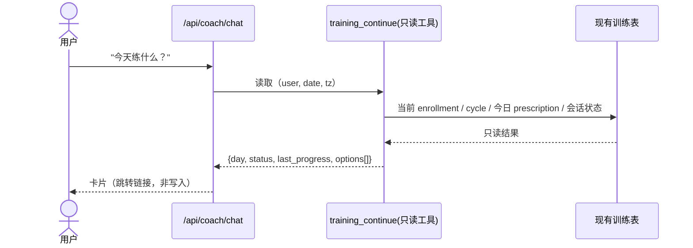

# PRD 06：继续今天的计划（训练分期的下一步）

状态：草案 · 依赖：Q20（读哪个接口）· 对应 Patch §1.1

## 1. 背景
Patch §1.1 的建议：首版小爪只接"训练查询 + 实际运动补记"，**不做"练某部位就随机拼动作"**；下一阶段优先验证"帮助用户继续计划"。
我们已经有：实际运动补记、当天查询。还缺：**"今天有什么既有训练可以继续"→ 跳回现有执行器**。

## 2. 目标
用户问"今天练什么/我练到哪了" → 小爪读**当前方法论/循环、最近真实执行、未完成状态** → 给出一张卡片 → 点击跳到现有训练页。
**硬约束（HANDOFF §4）**：不改处方；不代点完成某组；无匹配方案时说明并保留原计划，**不让模型自行编处方**。

## 3. 范围
含：只读查询（当前计划/进度/未完成）、卡片、跳转；可选短版/器械替换**仅限已定义且获准的规则**；"想练臀/肩"作为**筛选条件**映射到既有方法/计划。
不含：动作推荐引擎、随机抽动作、处方生成、聊天里点完成某组、漏练后"补回来"（Patch：顺延，不积欠练）。

## 4. 用户故事与验收
| ID | 故事 | 验收 |
|---|---|---|
| T1 | "今天练什么" | 卡片：今天的部位/第几天 + 上次做到哪；按钮"继续这次训练"→ 跳现有页 |
| T2 | 有未完成会话 | 明确"已开始未完成"，**不计为已完成**（与 `getDayFacts` 一致） |
| T3 | 今天是休息日 | 如实说休息日，**不催练** |
| T4 | "我想练肩" | 映射到适配的既有计划/天；若没有 → 说明 + 保留原计划，**不拼动作** |
| T5 | "时间不够" | 仅展示已审核的短版选项（若存在）；没有就说明并保留原计划 |
| T6 | 器械不全 | 仅展示已审核的替代；没有就保留原计划 |
| T7 | 聊天不写组记录 | 代码审查 + 测试：该路径无任何写 `set_executions` |

## 5. 方案

- 新增只读任务 `view_training`（`schemas.ts`）；数据来自**已有接口/表**（`/api/training/today` 的同源逻辑；具体复用方式要先读 `app/api/training/today/route.ts` 与方法运行时 SQL，**我本轮没读，Q20**）。
- 跳转目标：现有 `/training/today` 或会话页；聊天自己**不渲染也不执行**训练。
- 面板在 `/training/sessions/*` 不显示（现状已满足）。

## 6. 风险
| 风险 | 缓解 |
|---|---|
| 读取逻辑与训练页不一致 | 复用同一服务函数，不另写一套规则 |
| 误导成"今天必须练" | 文案中性；休息日不催；不用"补回来" |
| 模型想"帮忙"拼动作 | 工具白名单中**没有**生成动作的能力；提示词明确；评测覆盖 T4 |

## 7. 测试映射
B04（方法执行与镜像去重、未完成不算完成、不写组记录——**现有闭环里 B04 的方法夹具部分仍未测，这里要补**）。

## 8. 粗估与决定
粗估 3–5 人天（猜测，取决于训练接口可复用程度）。需要你决定：Q20；"短版/替代"目前是否有已审核的规则可用；是否要在卡片里显示"上次做到 X 组"（会读 `set_executions`，属于只读）。
