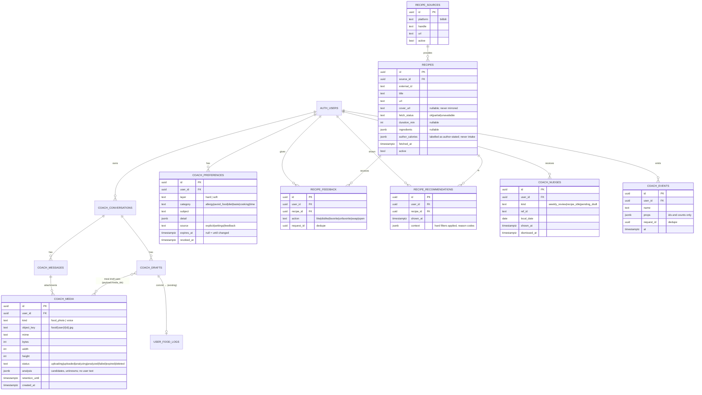
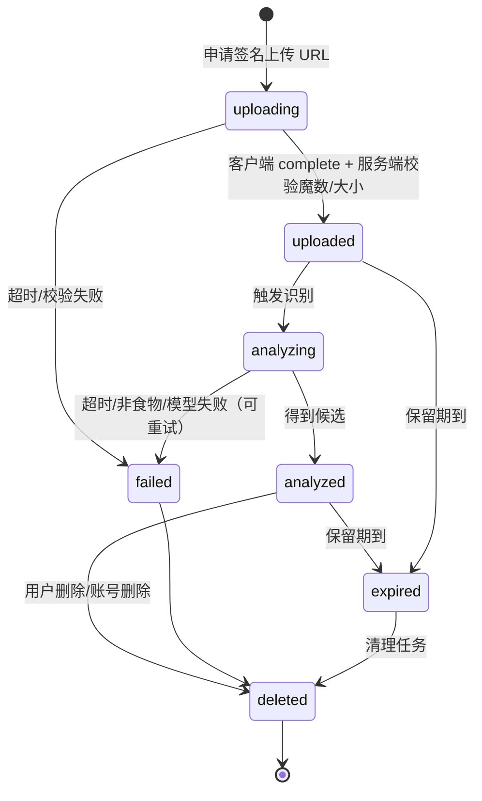
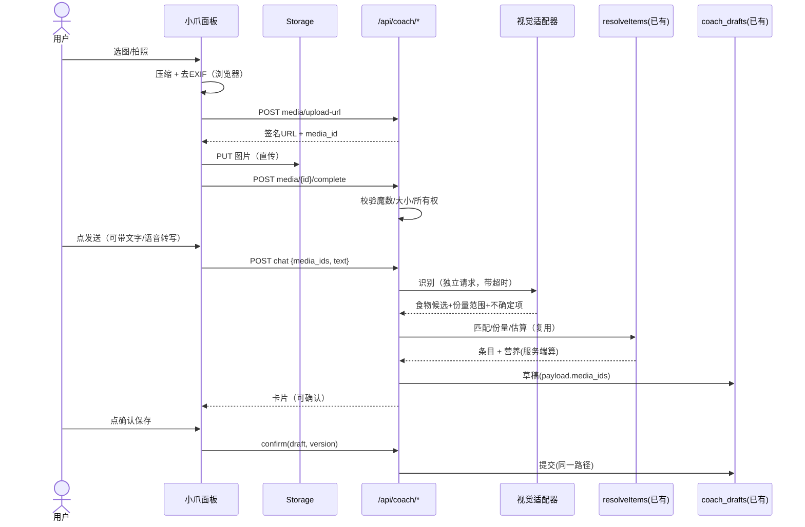
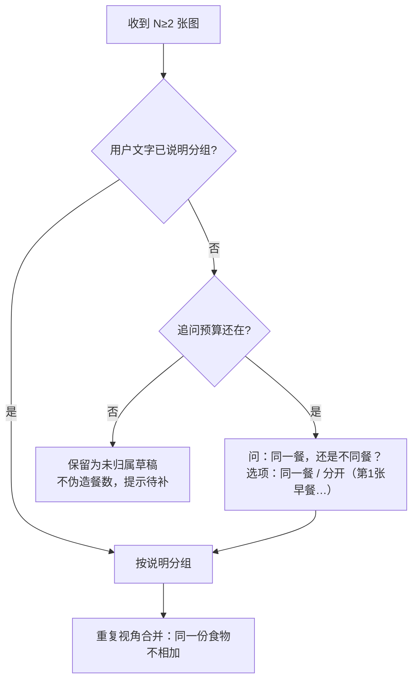

# 数据模型、接口与状态机（草案）

**全部是设计草图，没有应用到任何数据库。** DDL 片段只表达意图，真正迁移要按仓库规范（RLS、授权、`USER_DATA_TABLES` 登记、本地仿真验证）重写。
**Storage 相关策略无法在本地仿真环境验证**（仿真库没有 Storage），上线前必须在真实 Supabase 上验证。

## 1. 实体关系



### 与现有表的衔接（不破坏）
- `coach_drafts.kind` 的检查约束要扩展（目前 `meal|meal_edit|workout|weight`）。新增草稿类型**尽量不要**：照片/语音/食谱最终都落到现有 `meal` 草稿，只在 payload 里加 `media_ids`、`source: 'photo'|'voice'|'recipe'`。这样确认、幂等、版本检查、导出删除全部复用。
- `ai_generations.surface` 已含 `coach_chat`；视觉识别、转写是**不同的模型调用**，建议新增 `coach_vision`、`coach_transcribe` 两个 surface（要改约束；或统一记在 `coach_chat` 下用 `scope_id` 区分，省一次改约束）。
- `USER_DATA_TABLES`：以上每张用户表都要登记（`tests/account/user-data-coverage.test.ts` 会拦）。`recipes`/`recipe_sources` 不是用户数据，不登记。
- 所有新增用户表 RLS：本人读写；`user_id` 不可重分配（沿用 `coach_*` 的策略写法）。

## 2. 对象存储（草图）

桶：`coach-media`（私有）。路径：`food/{user_id}/{media_id}.jpg`、（语音若需临时落盘）`voice/{user_id}/{media_id}.m4a`。

```sql
-- 仅表达意图；未验证
create policy coach_media_own_read on storage.objects for select to authenticated
  using (bucket_id = 'coach-media' and (storage.foldername(name))[2] = (select auth.uid())::text);
create policy coach_media_own_write on storage.objects for insert to authenticated
  with check (bucket_id = 'coach-media' and (storage.foldername(name))[2] = (select auth.uid())::text);
-- 不提供 update/delete 给客户端：删除走服务端接口，便于同时清元数据
```
服务端校验（不信任客户端）：魔数（JPEG `FFD8FF` / PNG / WebP `RIFF…WEBP`）、字节数上限、尺寸上限；不匹配则 `status=failed` 并删对象。

## 3. 状态机

### 3.1 媒体（照片）


### 3.2 一次照片记录（对话层，沿用草稿状态机）


### 3.3 多图分组（Patch §3.3）


## 4. 接口草图

均需登录 + `coach_chat` 功能位；业务结果统一 200 + `status`（与现有约定一致）。

| 方法 路径 | 用途 | 关键校验 |
|---|---|---|
| `POST /api/coach/media/upload-url` | 申请签名上传（`{kind, mime, bytes}`） | 类型白名单、大小上限、每日配额 |
| `POST /api/coach/media/[id]/complete` | 上传完成通知 | 魔数、实际大小、所有权；失败则删对象 |
| `POST /api/coach/media/[id]/analyze` | 食物识别（同步，带超时） | 状态必须是 `uploaded`；幂等（已 analyzed 直接返回） |
| `DELETE /api/coach/media/[id]` | 删除对象+元数据 | 所有权；级联到引用它的未确认草稿（置为失效） |
| `POST /api/coach/transcribe` | 语音转写（`multipart`，≤60s） | 类型/大小/频率限制；不落盘或处理后立即删 |
| `GET/POST/PATCH/DELETE /api/coach/preferences` | 偏好管理 | 本人；硬限制写入需 `explicit` 来源 |
| `POST /api/coach/recipes/recommend` | 推荐（返回真实入库候选） | 先过硬限制，再软偏好排序，近期去重 |
| `POST /api/coach/recipes/[id]/feedback` | 点赞/踩/收藏/换一个/打开 | `request_id` 幂等 |
| `GET /api/coach/nudge` / `POST …/[id]/dismiss` | 当天气泡 | 服务端按当地日期限频 |
| `GET /api/coach/training/continue` | 继续今天的计划（只读） | 不写任何训练数据 |

## 5. 错误分类（用户看到什么）

| 类别 | 例 | 用户文案原则 | 可重试 |
|---|---|---|---|
| 鉴权/权限 | 未登录、无权限 | 明确、不泄露存在性 | 否 |
| 校验 | 图太大、格式不支持、录音太长 | 说出具体限制和怎么办（"换 JPEG/PNG/WebP"） | 是（改后） |
| 配额 | 今日上传/转写次数到上限 | 说明明天恢复 + 可改用文字 | 否 |
| 超时 | 识别/转写超时 | "没认出来，可以换文字或再试一次" | 是 |
| 依赖不可用 | 模型/存储/转写服务故障 | 保留已输入内容；不伪装识别完成 | 是 |
| 冲突 | 草稿版本过期 | 说明已更新，看最新那张 | 否 |
| 结果未知 | 提交时断网 | 沿用现有 outcome_unknown 流程 | 是（幂等） |

## 6. 事件（Patch §12 埋点建议；只含 id 和计数，不含原文/图片/音频）

`chat_open` · `meal_input_started{mode:text|photo|voice|photo+voice}` · `media_uploaded{count,bytes}` · `analysis_done{latency_ms,candidates}` · `draft_ready` · `clarification_shown{about}` · `draft_corrected{op}` · `log_commit_success|failure{kind}` · `raw_log_saved` · `recipe_shown|changed|liked|disliked|favorited|opened` · `nudge_shown|dismissed{kind}` · `next_session_started`。
按 `request_id` 去重。**不做**：把任何事件接到第三方分析 SDK（隐私页承诺没有）。
