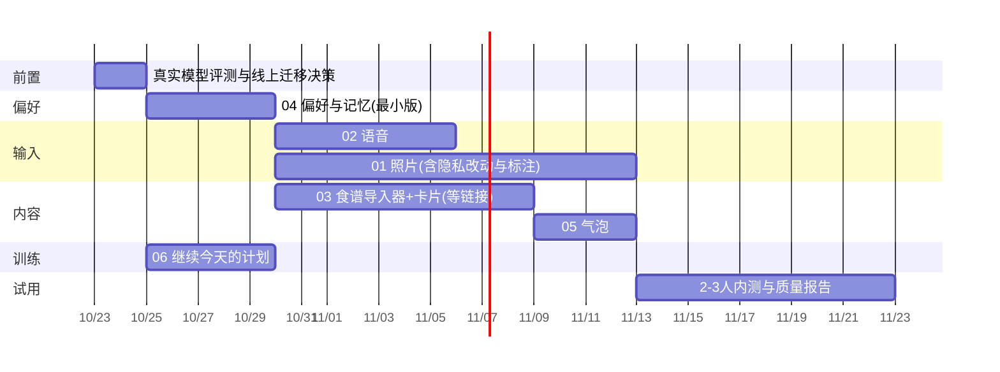

# 上线闸门、观察指标、实验与风险登记（草案）

适用于 01–06 所有后续功能，以及 PR #18 已实现的文字闭环。对应 Patch §10、§12。

## 1. 分阶段与退出条件（对应 Patch §10 的 A→E）

| 阶段 | 内容 | 退出条件 | 证据类型 |
|---|---|---|---|
| A 基线 | 对照代码、复核硬约束 | 基线差异有解释 | ✅ 已做（评估文档） |
| B 核心可靠性 | 草稿/幂等/日期/粗记录/运动/体重 | 文本新增/修改/刷新/重试/冲突测试通过 | ✅ 本地仿真通过；**线上库未验证** |
| C 饮食主链路 | 照片、语音、混合菜、卡片、汇总 | F01–F32 全部通过，含**真实模型与真机** | ⏳ 文字部分已做；照片/语音未做 |
| D 其他功能 | 偏好、食谱、气泡、训练延续 | 每个分支独立有通过证据 | ⏳ 本批提案 |
| E 集成与试用 | 跨任务、回归、导出删除、2–3 用户 | 无阻断缺陷；饮食质量报告完成 | ⏳ |

## 2. 上线闸门清单（Patch §12，逐条可勾）

对**每个**用户可见功能（照片/语音/食谱/偏好/气泡）：

- [ ] 对应 F/B 用例都有证据（通过/失败/阻塞/未执行，不能空着）
- [ ] 真实模型：识别/转写/推荐质量报告已出；**不是 mock**
- [ ] 真实存储、迁移、函数限制（超时、体积）已在**部署环境**核验
- [ ] 隐私文案与实际行为**逐条一致**（`app/privacy/page.tsx`、`docs/legal/LEGAL_BRIEF.md`）
- [ ] 官网 `lib/site/features.ts` 与 `components/site/screens.tsx` 同步为**真实状态**；`npx vitest run tests/site` 通过
- [ ] 可按用户/子功能关停，关停后**降级回手工页**，新数据不丢，旧客户端可用
- [ ] 回滚方案：**优先关开关**；不为回滚直接删用户日志，不做破坏性逆迁移
- [ ] `tests/devices/no-ai.test.ts` 通过（设备数据不进 AI）
- [ ] 账号导出/删除覆盖新表与对象（`tests/account` 通过 + 对象层人工核对）
- [ ] 最终 handoff：变更文件、迁移、测试报告、配置变量名（不含值）、残余限制、部署/回滚步骤

> **食谱的额外闸门**：真实指定来源已接通；否则标"内容阻塞"，**不能对外称整版完成**（Patch §12.2）。

## 3. 功能开关（现有 + 建议）

| 开关 | 层级 | 现状 | 说明 |
|---|---|---|---|
| `PAWSIDE_COACH_CHAT=0` | 环境，全员 | ✅ | 总开关 |
| `coach_chat` | 用户（`user_features`） | ✅ | 默认关闭 |
| `PAWSIDE_COACH_CHAT_MEALS/WORKOUTS/WEIGHT=0` | 环境，子功能 | ✅ | |
| `coach_photo` | 用户 | 建议 | 照片；需在隐私页就绪后才可对任何人开 |
| `coach_voice` | 用户 | 建议 | 语音 |
| `coach_recipes` | 用户 | 建议 | 食谱+推荐 |
| `coach_nudges` | 用户 | 建议 | 气泡；设置里允许用户关 |
| 对应子功能环境开关 | 环境 | 建议 | 出问题时无需发版即可关 |

原则：**功能位默认关**；开一个人，先自己，再 2–3 名内测；每个子功能独立可关；关闭**不删数据**。

## 4. 试用设计（Patch §12：2–3 名 A/B 用户）

**诚实边界**：2–3 个用户只能给**定性与可用性证据**，**不能**声称统计提升。数值下降也可能是"不再需要"，要访谈。

### 观察什么
| 问题 | 看什么 | 方法 |
|---|---|---|
| 比原来省事吗？ | 输入到保存的**主动操作数**、花费时间、追问/纠正次数 | 对照原手工流程；录屏（征得同意）或事件 |
| 识别失败后还能继续吗？ | 失败后继续的比例；是否转文字/粗记 | 事件 + 访谈 |
| 不理想的一餐还愿意记吗？ | "尝试记录但中断" vs "根本没想记录"（**分开统计**） | 事件 `meal_input_started` 无 `log_commit_success` |
| 推荐解决了一顿饭吗？ | 推荐 → 草稿的比例 | 事件 |
| 有没有被打扰？ | 气泡关闭率、面板主动关闭 | 事件 |

### 留存观察（只记录，不下因果结论）
每周实际记录天数、实际训练次数、漏记后回归、7 日内再次使用、连续 4 周使用。
**不把训练计划持续使用的优势写成已验证的留存结论**（Patch §1.1 末段）。

### 事件与隐私
事件清单见 `09` §6；**只含 id 和计数**；按 `request_id` 去重；图片/音频原文**不进**分析事件；不接第三方分析 SDK。

## 5. 里程碑与建议排期（粗略，**无历史速度数据校准**）

**这张图只是顺序与相对大小的示意，不是承诺。** 照片的 14 天里大部分是等外部条件（桶、标注、隐私）。

## 6. 风险登记（全局）

| # | 风险 | 可能性 | 影响 | 缓解 | 负责 |
|---|---|---|---|---|---|
| R1 | 真实模型对中文口语理解不达标 | 中 | 高 | `coach:eval` 先行；换模型/改提示词；服务端兜底已限制后果 | 你+我 |
| R2 | Netlify 函数超时导致照片/转写失败 | 中 | 高 | 直传+独立请求+限时降级；先测 p95 | 你查数值 |
| R3 | 隐私承诺与行为不一致 | 低（有闸门） | 极高 | 闸门清单；隐私页逐条对 | 你+我 |
| R4 | 用户把估算当事实 | 中 | 中 | "估算/待补"标注；不承诺准确率；一句话可改 | — |
| R5 | 过敏相关误导 | 低 | 极高 | 缺配料即排除/标无法确认；文案不保证；硬限制不可放宽 | — |
| R6 | 食谱来源条款/链接问题 | 中 | 中 | 白名单；只存元信息与外链；你判断条款 | 你 |
| R7 | 气泡变成打扰 | 中 | 中 | 每日一个（库约束）；先只开周报；看关闭率 | — |
| R8 | 清理任务没落地导致照片/日志超期保留 | 中 | 高 | ADR-010；**清理上线前不开放照片**；顺带兑现 `ai_generations` 90 天 | 我 |
| R9 | PostgREST 版本差异（如 40001 重试） | 中 | 中 | 用 `PT409` 约定；线上验证 Q2 | 你验证 |
| R10 | 本地仿真≠线上 | 中 | 中 | 每个功能上线前在**分支库/预发**复跑集成测试 | 我 |
| R11 | 2–3 用户样本小，结论过度 | 高 | 中 | 只作定性；明确写边界 | — |
| R12 | 提示词改动引起回归 | 中 | 中 | 升版本号 + `coach:eval` + 重复运行看通过率 | 我 |

## 7. 沟通与交接
- 每个功能做完交付：PR 说明（中文）、测试报告（带证据类型）、决策日志更新、待答问题清单。
- 不直接推 master、不自行合并（HANDOFF）；官网/隐私文案与功能状态**同一个 PR** 里同步。
