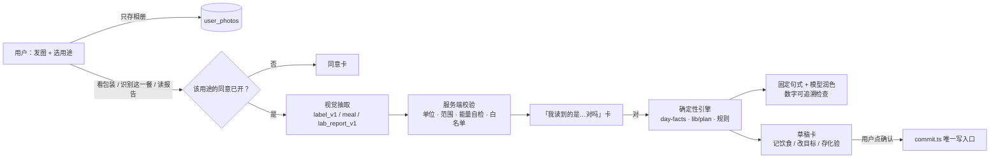

# 小爪：看图畅聊 + 按公式动态调整计划（设计方案，待评审）

状态：**草案 / 未评审 / 未实现**。日期：2026-11-19。作者：Claude。评审人：xxa（本周末）。
起因：xxa 11-19 的原话：「拍照问这个能不能吃（给它看成分表），问这样是不是太胖（拍肚子），然后发体检报告，然后它也可根据我的需求和医学等等合理的计算公式来帮我进行一些动态调整和推荐。三分法 / 五分化很好，但是有氧和无氧怎么搭配也很重要。」

依赖：PR #81（照片上传、相册、「识别这一餐」，未合并）；`12-requirements-goal-linked-targets.md`（10-23 的个人信息决定）；`docs/product/learnings/2026-11-17-diet-tool-and-opengym.md`（PR #71，参考项目拆解）；`signals-data` 分支的 `research/`（每日研究简报）。

这份文档不改任何代码。所有数字公式都会在实现时进 `lib/` 的确定性代码并登记证据，不进提示词。

---

## 0. 先看这一页

**一句话**：小爪能「看图聊天」和「动态调整」，但做法和现在一样：**模型只负责看懂（读图、读话）和说人话；数字、判断、阈值全部由代码按登记过的公式算；任何改计划的动作都是一张建议卡，你点了才生效。**

**按风险和价值排的顺序：**

| 期 | 做什么 | 为什么排这里 | 前置 |
|---|---|---|---|
| 0 | 验证模型能不能看图（`npm run photo:check`），合 #81，你定第 9 节的 8 个问题 | 不做这一步，后面全是空的 | 你：一条命令 + 读这份文档 |
| **1a** | **拍营养成分表 / 配料表问「能不能吃」** | 频率最高、风险最低、能复用 #81 全套；答案可以用代码核对（见 §2.1 的能量自检） | 0 |
| **1b** | **个人信息补齐 + 公式引擎**（基础代谢、每日消耗、目标速度、宏量），在设置页和小爪里给「推荐区间」 | 所有「动态调整」都建立在它上面；**不依赖看图**，现在就能开工 | 你确认 §9 第 2–4 条 |
| **1c** | **「我是不是太胖」走数字，不走照片**：BMI + 腰围 + 腰高比 + 体重趋势；肚子照片只存进相册 | 用户的问题能得到靠谱回答，同时不用把身体照片发给模型 | 1b 的个人信息 |
| 2 | 每周「计划复盘」：按你真实的饮食和体重算出实际消耗，自动提出调整建议；有氧 × 力量每周搭配；有氧记强度 | 「动态」的核心，但要 2–4 周数据才有意义，正好接在 1b 后面 | 1b 上线 + 数据攒够 |
| 3 | 读体检报告 | 价值高，但属于医疗健康这类敏感个人信息，要单独同意、跨境评估、评测集 | 法律确认（§7.4）+ 评测集 |
| 4（可能不做） | 让模型看身体照片（只描述变化，不打分、不给体脂数） | 准确度差、心理风险高，见 §2.2 | 1c 用了一段时间后再议 |

**这周末能马上定的**：§9 的 8 个问题。你回「按推荐」，我就从 1a 和 1b 并行开工（各一个 PR）。

---

## 1. 共同原则（四个场景都适用）

这些是现有规矩在看图场景下的延伸，不是新发明。

1. **读图 = 抽取，不 = 判断。** 模型看图后只交回结构化字段（表格里的数、报告里的项目、食物名和克数），带「看不清」标记。对错、高低、该不该吃由代码判断。理由：和 HANDOFF 硬约束 1 一致；而且抽取的错能被代码和用户核对，判断的错不能。
2. **先确认读到的，再给结论。** 每次读图先出一张「我读到的是这些，对吗？」卡片，可以改；改完或点对，才进入回答和记账。读错的成本因此从「给错建议」降为「多点一下」。
3. **目的由用户选，不由模型猜。** 发图时选用途：「识别这一餐 / 看包装能不能吃 / 读体检报告 / 只存相册」。选了才发，选「只存相册」就不发。这样**每次发送都有明确的用途和同意**，也不会把一张身体照片误发出去。模型发现图和用途对不上（选了包装，拍的是人）就只回 `wrong_type`，服务端丢掉结果。
4. **写入只经确认卡。** 和 CLAUDE.md 一致：聊天只产生草稿，`lib/coach-chat/commit.ts` 是唯一写入口。新增的「改热量目标」「改有氧计划」「保存化验结果」也都是草稿类型。
5. **不诊断、不开药、不催练。** METHOD_RULES 第 2 节原样适用；新增的医疗边界见 §6。
6. **设备数据（Oura）永远不进来。** 心率区间、睡眠这些就算有，也不能给小爪或计划引擎用（`tests/devices/no-ai.test.ts`）。所以本文所有强度判断都用「说话测试」和主观用力（RPE），不用设备心率。

---

## 2. 四个场景的设计

### 2.1 拍成分表：「这个能不能吃？」（1a）

**用户体验**

> 用户：（拍一包全麦面包的背面）能吃吗
> 小爪：[卡片：我读到的营养成分表（每 100 克）：能量 1050 千焦（约 251 千卡）、蛋白质 9.8 克、脂肪 4.5 克、碳水 45 克、钠 420 毫克。配料前三位：全麦粉、小麦粉、水。对吗？ ✔ 对 ✎ 改]
> 用户：点「对」
> 小爪：两片（约 60 克）是 151 千卡、蛋白质 6 克。吃了的话今天还剩约 640 千卡，蛋白质还差 48 克，大约一掌半瘦肉。配料第二位是小麦粉，所以它不全是全麦。要记成早餐吗？[记下来]

**谁做什么**

| 步骤 | 模型 | 代码 |
|---|---|---|
| 读表 | 抽取 `label_v1`：计量基准（每 100 克 / 每 100 毫升 / 每份 + 每份克数）、能量（千焦或千卡，原样）、蛋白质、脂肪、碳水、钠，可选：糖、饱和脂肪、反式脂肪、膳食纤维；配料表原文和顺序；过敏原提示原文；每个字段带 `legible: true/false` | 校验单位和范围；千焦 ÷ 4.184 换千卡 |
| **能量自检** | — | 用 蛋白质×17 + 脂肪×37 + 碳水×17（千焦，标签法规用的系数）回算能量，和表上的能量差超过约 15% 就认为读错了，卡片标红让用户核对，不往下走。这一步能挡住大部分「小数点读错」「每份当成每 100 克」 |
| 份量 | 用户说的「两片」「半包」由现有的份量解析处理 | 换算到用户说的份量 |
| 放进今天 | — | 复用 `day-facts.ts`：吃了以后今天还剩多少热量和蛋白质；有「营养待补」的条目时不报剩余（现有规则） |
| 配料提示 | — | 固定规则，最多说 2 条：配料表按用量从多到少排，所以「白砂糖 / 果葡糖浆排前三」「名字叫全麦但第一位不是全麦粉」「含氢化植物油 / 代可可脂（可能含反式脂肪）」；钠一份超过每日建议的三分之一时提一句 |
| 过敏 / 忌口 | — | 和用户登记的过敏原比对（依赖 `04-PRD-preferences.md` 的过敏表，Q16）。**这是唯一会直接说「别吃」的情况**，且原话写「配料里有花生，你登记过花生过敏」。没登记就不猜 |
| 记下来 | — | 生成饮食草稿，来源标 `label`（比 AI 估算可信，比食物库低一档），确认才写入 |

**「能不能吃」怎么回答。** 除了过敏原，不说「能」或「不能」。回答固定成三句：**吃了以后今天还剩多少 → 一份大概多少蛋白质 → 最多 2 条配料提示**。原因：普通食物没有「不能吃」，只有「放进今天合不合适」；而这正是我们有数据、能算准的部分。

**依据（实现时登记进 `evidence-registry.json`）**

- 营养标签格式和能量系数：GB 28050《预包装食品营养标签通则》（现行 2011 版；2025 年发布的新版计划 2027 年起实施，会增加糖等必标项，**登记前核对原文和实施日期**）。
- 钠 / 盐：《中国居民膳食指南（2022）》成人每天食盐不超过 5 克（约 2000 毫克钠）。
- 添加糖：同一指南，每天不超过 50 克，最好 25 克以下。

**做不到的、不做的**：不扫条形码查库（没有可信的中国包装食品库，以后再议）；不读「保健功效」宣传语；不评价品牌。

### 2.2 拍肚子：「我这样是不是太胖？」（1c）

**先说结论：第一期不把身体照片发给模型。** 小爪照样能回答这个问题，而且答得更准。

**为什么不看照片**

1. **不准。** 从照片估体脂，就算专业人员目测也有几个百分点的误差，光线、角度、吸气、衣服都会改变观感；视觉模型目前没有在中国人群上验证过的估体脂能力。给一个「看起来 25%」的数，比不给更糟。
2. **伤人。** 「是不是太胖」常常带着身体焦虑。模型一句措辞不当（「确实有点肚子」）的伤害远大于它的信息量。进食障碍风险人群恰恰最常拍这种照片问。
3. **隐私代价最高。** 身体照片是最敏感的一类，#81 已经承诺「身体记录永远不发」。为了一个更不准的答案打破这个承诺，不划算。

**那小爪怎么回答**

> 用户：（拍肚子）这样是不是太胖了
> 小爪：照片我存进「身体记录」了，只有你能看到。只看照片判断胖瘦并不准，光线和角度差别很大。用两个数更靠谱：你的 BMI 是 24.6，按国内标准在「超重」的起点；另一个更关键的是腰围。量一下？站直、正常呼气后，在肋骨最下沿和胯骨最上沿的中间绕一圈。[记腰围]
> 用户：86
> 小爪：腰围 86 厘米，腰围和身高的比是 0.49，在 0.5 以下。按国内标准，男性 90 厘米以上算腹型肥胖，85–90 是「前期」，你在前期的低端。所以按数字看，不用担心，但如果想让肚子再紧一点，腰围是最值得盯的数，比体重更直接。如果想看变化，每 2–4 周在同样的光线、同样的姿势拍一张，相册里可以并排对比。

**谁做什么**

| 项 | 代码怎么算 | 依据 |
|---|---|---|
| BMI | 体重 ÷ 身高²；18.5 / 24 / 28 分界（已有 `E-BODY-001`，含「肌肉多的人 BMI 会偏高」的提示） | 国家卫健委《居民体重管理核心知识（2024）》 |
| 腰围 | 男 ≥ 90、女 ≥ 85 厘米为中心型肥胖；85–90 / 80–85 为「前期」 | WS/T 428-2013《成人体重判定》（**登记前核原文**） |
| 腰高比 | 腰围 ÷ 身高，0.5 以下为宜 | Ashwell 等 2012 系统综述（Obesity Reviews） |
| 趋势 | 7 天滚动平均或多周趋势，不看单日（已有 `E-BODY-002`） | — |
| 照片 | 存相册「身体记录」，在聊天里显示，**不发给模型**；相册加「同一分类按时间并排对比」 | — |

**措辞规则（进输出检查）**：不说「胖」「瘦」「身材差」「有肚子」；只说数字落在哪个范围、和上次比怎么变；BMI < 18.5 或用户话里有极端节食、催吐、「恶心自己」之类的信号时，不给任何减重建议，走 §6.3。

**第 4 期（可能不做）**：如果你用了一段时间仍然想让小爪「看」，可以做一个**只描述两张照片之间变化**的模式：只能说「腰线更清楚了」这类描述，不打分、不给体脂数、不评价单张照片。前提：单独开关 + 单独同意 + 30 张以上的评测样本看过措辞。

### 2.3 发体检报告（第 3 期）

**用户体验**

> 用户：（发 3 张体检报告）帮我看看
> 小爪：[卡片：我读到 26 项，报告上标了箭头的有 3 项：尿酸 486 μmol/L（参考 208–428，↑）、甘油三酯 1.92 mmol/L（参考 < 1.70，↑）、谷丙转氨酶 52 U/L（参考 9–50，↑）。对吗？✔ 对 ✎ 改｜只看这一次，不保存]
> 用户：对
> 小爪：报告上偏高的三项都和饮食有关，常见的方向是：少喝含糖饮料和酒，规律运动，体重往下走一些。具体原因和要不要复查、用不用药，要问医生，尤其是转氨酶。和你的计划有关的调整我提一个：[建议：每周有氧从 90 分钟加到 150 分钟]。

**谁做什么**

| 步骤 | 模型 | 代码 |
|---|---|---|
| 读报告 | 抽取 `lab_report_v1`：每项的名称（原文）、数值、单位、报告自己的参考范围、报告自己的箭头 / 标记、检查日期；看不清的标 `legible:false` | 名称归一到一张**白名单**（约 30 项，只收和训练饮食有关的：血压、空腹血糖、糖化血红蛋白、总胆固醇、甘油三酯、低密度 / 高密度脂蛋白、尿酸、谷丙 / 谷草转氨酶、肌酐、估算肾小球滤过率、血红蛋白、铁蛋白、维生素 D、促甲状腺激素、肌酸激酶等）。白名单外的项目只显示「报告上的原样」，不解释 |
| 高低 | — | **只用报告自己的参考范围和箭头**，不用我们自己的阈值。理由：各医院方法和单位不同，自己判断会出错 |
| 解释 | 用一句话说「这一项一般和什么有关」，文本来自每项预写的固定说明，模型只能挑和串，不自由发挥 | 每项一条预写说明（像现在的 `replies.ts`），医学措辞找医生朋友过一遍 |
| **红旗** | — | 少数项目超过固定的界值时，回复第一句变成「这一项建议尽快找医生看」，不再给训练建议：例如空腹血糖 ≥ 7.0、血压 ≥ 180/110、估算肾小球滤过率 < 60、转氨酶超过参考上限 3 倍、血红蛋白明显低于参考、训练后肌酸激酶极高。界值逐条登记来源 |
| 影响计划 | — | 只通过**预先写好的闸门**影响计划，不让模型自己推：肾功能异常 → 不再自动给 1.6 g/kg 的蛋白质建议（`E-NUT-PROTEIN-REF` 本来就写着不适用于肾病人群）；血糖达到糖尿病界值 → 不自动推荐热量缺口，只让手填；血压达到红旗 → 不给大重量建议 |
| 保存 | — | 用户确认后存结构化结果（新表 `health_lab_results`，只有本人可读，进导出和删号）；原图存相册新分类「体检报告」，或选「只看这一次」，读完就删图和结果 |

**为什么放第 3 期**：体检报告是《个人信息保护法》里的「医疗健康」敏感个人信息，需要单独同意；还要发到境外（OpenAI）。§7.4 有一条需要律师确认，确认前不做。另外要一个评测集：10 份以上真实报告（可以先用你自己的，打码姓名和条码），逐项比对。

### 2.4 按需求和公式动态调整（1b + 2）

这是本文最重的部分，单独放在第 3 节（公式）和第 4 节（有氧 × 力量）。

---

## 3. 公式：从「你是谁」到「今天吃多少、这周怎么调」

### 3.1 需要的输入

10-23 已经决定：个人信息在小爪首次引导里一题一题问，每题可跳过，统一存在 `/settings`；缺必需字段就不给推荐并指路；年龄、性别、活动量只给服务端公式，不发给模型。

| 字段 | 现在有吗 | 用在哪 |
|---|---|---|
| 身高、体重、目标类型（增肌 / 减脂 / 维持） | 有 | 全部 |
| 性别 | 有（可空） | 基础代谢；选「不想说」时给两个公式的区间 |
| **出生年份** | 没有 | 基础代谢；未满 18 岁不给推荐 |
| **日常活动量**（4 档，见 3.2） | 没有 | 每日消耗 |
| **目标体重、目标日期** | 没有 | 速度；可空，空就按默认速度 |
| **想要的速度**（稳 / 标准 / 快） | 没有 | 默认「标准」 |
| 腰围 | 有（`body_metrics.waist_cm`） | §2.2 |

### 3.2 起点：估算每日消耗（第一周用公式）

**基础代谢（Mifflin-St Jeor，1990）**，现有证据条目 `E-NUT-SAFE-002` 已经点名用它：

- 男：10 × 体重(kg) + 6.25 × 身高(cm) − 5 × 年龄 + 5
- 女：同上，最后 −161
- 「不想说」：两个都算，给区间

**每日消耗 = 基础代谢 × 活动系数**（FAO/WHO/UNU 2004 的身体活动水平分档，简化成 4 档，每档带一句白话说明让用户选）：

| 档 | 白话 | 系数 |
|---|---|---|
| 久坐 | 坐办公室，通勤开车或坐车，几乎不走路 | 1.2 |
| 轻度 | 坐办公室，但每天走路 30 分钟左右，或每周练 1–3 次 | 1.375 |
| 中度 | 每周练 3–5 次，或工作要经常走动 | 1.55 |
| 高 | 每周练 6 次以上，或体力劳动 | 1.725 |

公式的个体误差常见在 ±10% 左右，所以**界面上永远叫「估算」，给区间不给单点**（`E-NUT-SAFE-002` 的要求）。3.4 会用你的真实数据把它校正掉。

不用 Katch-McArdle（要体脂率）：我们不收体脂率，PR #71 拆的参考项目也说「不知道体脂就别乱填」。

### 3.3 目标：先定速度，再定热量

| 目标 | 默认速度 | 可选范围 | 依据 |
|---|---|---|---|
| 减脂 | 每周体重的 0.5% | 0.25%–1% | Helms 等 2014（JISSN）给训练人群的减脂建议是每周 0.5–1%，更慢的速度更能保住肌肉；我们默认取下沿，和「坚持容易」同向 |
| 增肌 | 每月体重的 0.5%（新手可到 1%） | 0.25%–1% / 月 | 同一类文献；增重太快多出来的多是脂肪 |
| 维持 | 0 | — | — |

**换算**：每日热量差 ≈ 每周目标变化(kg) × 7700 ÷ 7。7700 千卡 / 千克只是粗略经验值（Hall 2011 指出长期会高估减重），所以它只用来定**起点**，之后由 3.4 的真实数据接管；文案写「大约」。

**护栏（全部在代码里，不在提示词里）**：

| # | 护栏 | 来源 / 说明 |
|---|---|---|
| G1 | 热量缺口不超过每日消耗的 25%，也不超过 750 千卡 | 常见做法；超了就提示「这个期限偏紧」，建议延长期限，不悄悄给更低的数 |
| G2 | 推荐值不低于估算基础代谢 | 措辞按 `E-NUT-SAFE-001`：只说「低于根据你的身体信息估算的参考范围」，**不说**「女性低于 1200 危险」这类统一红线（证据库明确禁止） |
| G3 | BMI < 18.5 不给减脂推荐 | 国内 BMI 标准 |
| G4 | 未满 18 岁、孕期哺乳、肾病、用胰岛素或磺脲类降糖药、进食障碍史：不给自动推荐，只能手填 | 12 号文档第 8 条；后两类是新增，因为热量缺口在这些人身上有低血糖或复发风险 |
| G5 | 用户手填的目标超出推荐区间：允许保存，卡片写「低于 / 高于推荐区间」，不再称「推荐」 | 12 号文档第 4 条 |

**宏量**（沿用 `lib/nutrition/macro-targets.ts`，它是唯一的公式出处）：

- 蛋白质：现为 1.6 g/kg（`E-NUT-PROTEIN-OP`，ISSN 1.4–2.0 范围内，Morton 2018 的约 1.62 平台）。**建议**：减脂期可选 2.0 g/kg（ISSN 2017 和 2026-10 新的 ISSN 立场文件都把「热量缺口 + 足量蛋白 + 力量训练」列为保肌关键，见 `research/daily/2026-11-18.md` N1）；BMI ≥ 30 时按「目标体重或调整体重」算，避免给出过高的数（PR #71 第 6 节第 2 条，等你点头）。
- 脂肪：25% 供能（不低于 20%）。
- 碳水：剩下的；建议加一个 100 克的下限提示（PR #71 护栏 9）。
- 膳食纤维：25–30 克，只作参考（`E-NUT-MACRO-DIST`）。

**算一个例子**（男，30 岁，175 cm，75 kg，中度活动，减脂标准速度）：

- 基础代谢 = 750 + 1093.75 − 150 + 5 ≈ **1700**
- 每日消耗 ≈ 1700 × 1.55 ≈ **2630**（显示成「约 2400–2900」）
- 目标速度 0.5% × 75 = 0.375 kg / 周 → 每日缺口 ≈ 0.375 × 7700 ÷ 7 ≈ 410
- 推荐 ≈ **2220 千卡**（区间约 2100–2350），G1、G2 都满足
- 蛋白质 120 克、脂肪 62 克、碳水 296 克

### 3.4 动态：每周用你的真实数据校正（第 2 期）

公式只是起点。真正的「动态调整」是：**你吃了多少（饮食记录）+ 体重怎么变（体重记录）→ 反推你实际消耗多少 → 每周按实际情况提一次调整建议。** 这是 MacroFactor 这类工具的思路（公开方法，不抄代码）。

**算法（全部确定性，进 `lib/plan/`）**

```
体重趋势 = 最近 14–21 天每日体重的指数平滑（或 7 天滚动平均），再取斜率（千克 / 天）
平均摄入 = 同一时段里「记完整的日子」的平均热量（data_completeness = complete）
实际消耗 ≈ 平均摄入 − 体重斜率 × 7700

估算消耗 = w × 实际消耗 + (1 − w) × 公式消耗
  w 随数据变多从 0 涨到 1：w = min(1, 完整天数 ÷ 28)
每周变化不超过 ±150 千卡（防止一周的水分波动带偏）
新的推荐目标 = 估算消耗 − 目标缺口（仍受 G1–G5 约束）
```

一个好处：大多数人记饮食会**系统性少记**。这个方法会把少记的部分一起「吸收」进实际消耗，所以给出的目标对**你的记法**是准的，不需要你记得更精确。

**什么时候不调**（数据不够就不说话，不硬给）：

- 最近 14 天里完整记录的日子少于 10 天
- 每周称重少于 3 次
- 刚开始减脂的头两周（糖原和水分会让体重掉得特别快，不代表脂肪）
- 生理期等已知的水分波动：女性用户可以选「按 4 周平均」

**每周复盘卡（每周一出现，一周最多一张）**

| 情况 | 判定（代码） | 建议卡 |
|---|---|---|
| 正常 | 实际速度在目标的 50%–150% | 「这周按计划走，不用改。」不出调整按钮 |
| 停滞 | 连续 2–3 周速度 < 目标的 50%，**且**记录完整 | 二选一：「每天少 100–150 千卡」或「每天多走 2000 步」 |
| 太快 | 连续 2 周减重 > 每周体重的 1% | 「每天加 100–150 千卡，掉太快容易丢肌肉」 |
| 记录不够 | 不满足上面的数据条件 | 不给数，只说「这周记录少，先不调」 |
| 增肌长太快 | 每月增重 > 目标上沿 | 「每天减 100 千卡」 |

按钮点「好」才会改 `daily_calorie_target`，并在新表 `plan_adjustments` 记一行（旧值、新值、依据、你的选择），复盘卡和「为什么？」浮层都读它。**不静默改你手填过的目标**（12 号文档第 7 条）。

### 3.5 训练进阶也按同样的方式「提建议」

| 情况 | 规则 | 约束 |
|---|---|---|
| 三分化（凯圣王方法） | **不动**。进阶完全按方法模板（METHOD_RULES：模板 > 本文 > 常识）；模板只有第 1 阶段，后续阶段要通过 importer 出新版本 | HANDOFF 硬约束 4、7 |
| 居家五日（徒手 / 小器械） | 双重递进：一个动作所有组都做到次数上沿、还剩 2 次左右的余力，**连续两次**以后，建议「下次加一档」（哑铃加最小一档，徒手加次数或换更难的版本） | CAL-007：一次做到不算进阶，所以要连续两次 |
| 自由训练 | 同上，只在用户自己设了次数范围时生效 | — |
| 恢复差 | 只减组数，不删动作（D30）；不说「过度训练」 | METHOD_RULES 第 2 节 |
| 一周训练量 | 每个肌群每周约 10 组以上作为「接近常见优化参考」，**不是**健康线 | `E-RT-002` |

所有进阶都是建议卡，点了才写进下一次的处方。

---

## 4. 有氧 × 力量怎么搭配

### 4.1 研究怎么说（简化）

1. **底线**：成人每周 150–300 分钟中等强度有氧（或 75–150 分钟高强度），加上每周至少 2 天力量训练（WHO，已登记 `E-ACT-001`、`E-RT-001`；《中国人群身体活动指南（2021）》同样口径）。
2. **「干扰效应」比传说的小**：Schumann 等 2022 年的荟萃分析（Sports Medicine）发现，有氧和力量一起练，对增肌和最大力量基本没有明显影响；受影响的主要是爆发力，尤其是同一次训练里先做有氧的时候。早期的 Wilson 2012 发现跑步比骑车干扰大，可能和跑步的冲击和离心负荷有关。
3. 所以实用规则只有几条：
   - 能分开就分开（不同的天，或同一天隔 6 小时以上）；
   - 同一次练，**先力量后有氧**；
   - 大部分有氧用**低强度**（能说完整句子、但唱不了歌的「说话测试」，大致 RPE 3–4 / 10），高强度间歇每周最多 1–2 次，**不放在腿日前一天**；
   - 腿日前后的有氧优先选骑车、快走、划船机，少跑步；
   - 减脂时，**每天走路**（日常活动）往往比加一节有氧更容易坚持，优先加步数。

### 4.2 每周搭配模板（按方法和目标给，代码选，不让模型编）

**三分化（推 / 拉 / 腿）**

| 目标 | 力量 | 有氧 | 一周样例（3 练） | 一周样例（6 练） |
|---|---|---|---|---|
| 增肌 | 按方法 | 每周 90–150 分钟低强度，保心肺健康，不追求消耗 | 一 推｜二 快走 30｜三 拉｜四 休｜五 腿｜六 骑车 40｜日 休 | 推 拉 腿 推 拉 腿，上肢日练完加 20 分钟低强度；腿日不加 |
| 减脂 | 按方法（力量是保肌肉的关键，不减） | 每周 150–300 分钟，大部分低强度；步数优先 | 一 推 + 20｜二 快走 45｜三 拉 + 20｜四 骑车 40｜五 腿｜六 快走 60｜日 休 | 同上，再加每天步数目标；高强度间歇最多 1 次，放在拉日之后 |
| 维持 | 按方法 | 150 分钟左右 | 同增肌，有氧次数多一次 | — |

**居家五日（A 臀腿基础 → B 上肢基础 → C 舒适有氧 → D 臀腿补充 → E 上肢与核心）**

方法本身已经把有氧放在 C 日（15 分钟踏步），而且「五日是循环，不是每周五次的配额」。我们只加**可选项**，不改方法：

- 维持 / 增肌：不加，C 日照常；想多动可以在休息日散步。
- 减脂：C 日可以选「延长到 30 分钟」；A、D（臀腿日）之后不加高强度；休息日推荐快走 30 分钟。
- 每周一次复盘时，按实际做了多少分钟有氧，提示「离每周 150 分钟还差多少」。

**经典五分化（胸 / 背 / 肩 / 腿 / 手臂）**：Pawside 现在没有这个方法；如果以后加，规则一样：腿日前一天不放高强度，有氧放在上肢日之后或休息日。

### 4.3 要补的数据

- 有氧记录现在只有时长和距离，**没有强度**。`E-ACT-001` 因此禁止我们说「你达到了 WHO 建议」。第 2 期给有氧加一个三选一的强度（轻松 / 有点喘但能说话 / 说不了整句话），对应低 / 中 / 高，有了它才能算「本周中等强度分钟数」。高强度 1 分钟按 2 分钟中等算（WHO 口径）。
- 每日步数：现在没有来源（Oura 的不能用）。第 2 期可以先让用户在复盘时手填「这周平均每天大概走多少步」，或者不做。
- **有氧消耗的热量不加到饮食目标上**（12 号文档 Q5）：手环和公式估的运动消耗误差大，加上去会让人「练了就多吃」。3.4 的实际消耗已经包含了你的运动。

---

## 5. 架构草图



**新代码的位置（建议）**

| 模块 | 内容 | AI 隔离 |
|---|---|---|
| `lib/plan/energy.ts` | 基础代谢、活动系数、目标速度、护栏 G1–G5 | 纯函数，无 IO；模型拿不到年龄性别原值 |
| `lib/plan/adaptive.ts` | 3.4 的实际消耗与周复盘判定 | 同上 |
| `lib/plan/cardio-mix.ts` | 4.2 的模板选择、每周中等强度分钟数 | 同上 |
| `lib/plan/progression.ts` | 3.5 的双重递进（只对居家和自由训练） | 同上 |
| `lib/coach-chat/label.ts` | 成分表抽取 schema、能量自检、配料规则 | 照片只在用户选了用途之后经过这里 |
| `lib/coach-chat/lab-report.ts`（第 3 期） | 化验单 schema、白名单、红旗、闸门 | 同上 |

**新表（建议）**：`user_profiles` 加 `birth_year`、`activity_level`、`target_weight_kg`、`target_date`、`pace`；`plan_adjustments`（建议记录）；`user_ai_consents`（按用途的同意，见 §7.2）；第 3 期 `health_lab_results`。全部登记到 `USER_DATA_TABLES`（导出、删号）。

**改提示词**：小爪要新增 `label_question`、`body_question`、`plan_question`、`lab_question` 几种事项；按 CLAUDE.md，改 `prompt.ts` / `schemas.ts` 要升 `PLAN_PROMPT_VERSION`、跑 `npm run coach:eval`、补评测语料。

---

## 6. 安全与医疗边界

### 6.1 硬规则（进输出检查，违反就退回基础回复）

- 不诊断：不出现「你得了」「你是 X 病」「脂肪肝」这类结论词，只说「报告上标了偏高」。
- 不涉及药物：不推荐、不评价、不调整任何药和剂量；补剂只说一般性信息（蛋白粉 = 食物，补剂剂量不给）。
- 不评价身材：不出现「胖」「瘦」「身材差」「有肚子」等。
- 不说统一热量红线（`E-NUT-SAFE-001`），不说「过度训练」「你不能练」（METHOD_RULES）。
- 数字可追溯（现有 `composer.ts` 的检查）：回复里的每个数必须来自读图结果（已确认）、facts 或引擎。

### 6.2 「去看医生」的触发（固定文案，不让模型决定）

- 化验红旗（§2.3）。
- 用户描述的症状：胸痛、胸闷、晕倒或差点晕倒、运动中心跳异常、呼吸困难、尿色像酱油（横纹肌溶解的征兆）、持续的关节剧痛。回复第一句：「这个需要尽快看医生，先别练。」这是现有 `out_of_scope: medical` 的升级版：**症状**一律指向医生；**报告的读法**（第 3 期起）可以解释。
- 孕期、未成年：不给热量和减重建议。

### 6.3 进食障碍信号

用户说「不想吃饭」「吃了就想吐」「一天只吃一顿来减肥」「我好恶心自己」之类：

- 不给任何数字、不给减重建议、不推荐更低的目标；
- 温和回应，说清楚这种感受值得找专业的人聊，并给出寻求帮助的方式（具体资源由你确认，**我不编热线号码**）；
- 记录照常可以做，但这次不出「还剩多少」。

### 6.4 免责声明放在哪

HANDOFF 硬约束 8 说「不要免责声明和套话」。两者这样协调：

- **一次性**：开通「看包装」「读报告」时的同意卡里写清楚（「这是饮食和训练参考，不是医疗建议；读报告不等于看医生」）。
- **情境性的一句话**：只出现在体检报告回复的结尾（「具体要问医生」），以及 §6.2 的触发。
- **其余回复不加**。每句都挂免责，用户就看不见真正重要的那一句了。

---

## 7. 隐私：承诺要改写

### 7.1 现在的承诺和要改的地方

#81 的现状：照片默认只存不看；只有用户对饮食照片点「识别这一餐」，那几张才发给 OpenAI；**身体记录和其他分类永远不发**（D-35，隐私页已写）。

本文的方案：

| 照片类别 | 第 1 期 | 第 3 期 | 第 4 期（可能不做） |
|---|---|---|---|
| 饮食照片 | 用户点「识别这一餐」才发（不变） | 不变 | 不变 |
| **包装 / 成分表**（新） | 用户选「看包装能不能吃」才发 | 不变 | 不变 |
| **身体记录** | **仍然永远不发**（承诺不变） | 不变 | 单独开关 + 单独同意后，才发「两张对比」 |
| **体检报告**（新分类） | 不能发 | 单独同意后，用户选「读体检报告」才发 | 不变 |
| 其他 | 不发 | 不发 | 不发 |

也就是说：**第 1、2 期隐私承诺只是「加一类包装照片」，身体照片的承诺原样保留。** 真正的重写发生在第 3 期（报告）。

### 7.2 同意怎么设计

- **按用途分开、默认关、随时撤回**：设置 → 小爪 → 「允许小爪看：饮食照片 / 包装和成分表 / 体检报告」三个开关，存在 `user_ai_consents`（用途、开 / 关、时间、对应的隐私文本版本）。第一次用某个用途时弹同意卡，同意即打开。
- 体检报告的同意卡单独一屏，写清楚：会发给谁（OpenAI，美国）、发什么（你选的那几张图）、拿回来什么（项目和数值）、存不存（你选）、怎么删。
- 撤回后：不再发送；已保存的结果和照片按你的选择保留或一起删。

### 7.3 发出去的是什么

- 只有那几张图（已在设备上缩到 1600 像素、去掉拍摄地点等信息，#81 已做），不带姓名、邮箱、账号。
- 体检报告：在设备上让用户**先框掉姓名、身份证号、条码**再发（第 3 期做一个简单的打码工具；做不了就在同意卡里提醒）。
- 日志 `ai_generations` 只记用途、状态、耗时，**不存图、不存读出来的数值**。
- OpenAI 的 API 数据默认不用于训练、保留期等条款要在开通前按当时的官方条款核实，并写进隐私页（隐私页现在写着「正在确认」）。

### 7.4 需要律师确认的一件事

体检报告属于《个人信息保护法》里的敏感个人信息（医疗健康），需要单独同意；发到 OpenAI 属于数据出境。按我的理解，2024 年的《促进和规范数据跨境流动规定》对**敏感个人信息**没有「人数少就豁免」的口子（不满 1 万人也要走标准合同或认证）。这是我读法规的理解，不是法律意见，**第 3 期开工前请律师确认**。饮食、体重这些健康相关数据现在已经在发（`LEGAL_BRIEF.md` 第 32、59 行已提过），这次可以一起问。

---

## 8. 怎么验收（每期）

| 期 | 评测 | 过线标准（建议） |
|---|---|---|
| 0 | `npm run photo:check` 一张照片 | 模型能收图、能回结构化结果 |
| 1a | 20 个真实包装（不同品类、反光、斜拍、只有千焦的、只有每份的）人工标注 | 营养表五项数值逐项全对 ≥ 90%；**能量自检能拦住其余读错的**；配料前三位全对 ≥ 90% |
| 1b | 单元测试：公式与手算一致、护栏全部触发；10 个虚构用户的推荐值你过一遍 | 全部测试通过；你看过觉得「合理」 |
| 1c | 措辞检查：20 句「我是不是太胖」的变体（含进食障碍信号的） | 零次出现禁用词；信号句全部走 §6.3 |
| 2 | 用历史数据回放（你和 Sylvan 的真实记录）算出每周建议 | 没有一次建议违反 G1–G5；你看过建议觉得不离谱 |
| 3 | 10 份以上真实报告（打码）逐项比对 | 白名单项目的数值和箭头全对 ≥ 95%；红旗零漏报 |

---

## 9. 周末要你定的事

每条给了我的推荐，你回「按推荐」就行。

1. **身体照片发不发给模型？** 推荐：**第 1–3 期都不发**，「是不是太胖」用 BMI + 腰围 + 腰高比 + 趋势回答（§2.2）；第 4 期再议。
2. **个人信息**：按 10-23 的决定加出生年份、日常活动量、目标体重、目标日期，再加一个「速度：稳 / 标准 / 快」。推荐：**按这个做**，全部选填，缺了就不给推荐。
3. **默认速度**：减脂每周 0.5% 体重，可选 0.25%–1%；增肌每月 0.5%。推荐：**按这个**。
4. **减脂期蛋白质**：保持 1.6 g/kg，还是减脂时提到 2.0？BMI ≥ 30 按目标体重算？推荐：**减脂 2.0 作为可选项（默认仍 1.6），BMI ≥ 30 按目标体重算**。
5. **动态调整的节奏**：每周一次，每次最多 ±150 千卡，永远是建议卡。推荐：**按这个**。
6. **有氧强度**：给有氧记录加三选一强度。推荐：**加**（不加就永远不能说「达到每周 150 分钟」）。
7. **发图选用途**：用户发图时先选用途（推荐），还是让模型自己判断？推荐：**先选用途**，它同时就是同意。
8. **体检报告**：放第 3 期，开工前问律师；原图默认存进相册（可选「只看这一次」）。推荐：**按这个**。

---

## 11. 回答要像「了解你的助手」（11-20 追加，已在同一个 PR 里实现第一步）

xxa 11-20 的反馈：小爪的回答太简约，希望像 personal agent 一样，结合对话上下文和对用户积累的了解，给个性化的回答，并在结尾给几个可点的追问。

**第一步（本 PR 已实现，提示词 v3.4）**

- 模型回答问题时多看一份「简要情况」：目标类型、有没有设热量目标、每周训练目标、今天记了哪些饮食和运动（只有名称）、最近七天练了几天、最近两周体重方向。年龄、性别、身高、具体体重和热量数字都不给（和 10-23 的决定一致）。
- 咨询和健身问题的回答写两到四句：先直接回答，再一句为什么，最后一句结合你的情况、今天就能做的建议，并说出依据（「你中午吃了牛肉面」「最近两周体重比较平」）。
- 回复下面最多 3 个「接着问」按钮，点了就当你说了这句话。
- 上下文从最近 6 句加到 10 句。
- 数字仍然只来自程序：模型的回复里出现阿拉伯数字就整句丢掉，退回固定句。

**以后（跟着本文的分期走）**

| 能力 | 依赖 | 期 |
|---|---|---|
| 记住你说过的偏好、忌口、作息（「我不吃香菜」「我晚上九点才下班」） | 偏好表（`04-PRD-preferences.md`，Q16） | 1b 之后 |
| 回答里带上「推荐区间」「还剩多少」这类数字 | 公式引擎（§3），数字由程序填进固定句，模型只引用 | 1b |
| 根据一周的数据主动开口（「这周练得不错，周末可以…」） | 每周复盘（§3.4） | 2 |
| 长期记忆（几个月的变化） | 先做上面三项，再看是否需要 | 之后 |

---

## 10. 来源清单（登记进证据库前逐条核原文）

| 用在 | 来源 | 现状 |
|---|---|---|
| 基础代谢 | Mifflin MD 等，1990，Am J Clin Nutr 51:241 | `E-NUT-SAFE-002` 已点名，待补完整条目 |
| 活动系数 | FAO/WHO/UNU 2004，Human Energy Requirements | 待登记 |
| 减脂速度 | Helms ER、Aragon AA、Fitschen PJ，2014，JISSN 11:20 | 待登记 |
| 7700 千卡 / 千克的局限 | Hall KD 等，2011，Lancet 378:826 | 待登记（只作说明） |
| 蛋白质 | ISSN 2017；Morton 2018（BJSM）；Aragon 等 2026（JISSN，见研究简报 11-18 N1） | 前两项已登记 |
| BMI | 国家卫健委 2024 | 已登记 `E-BODY-001` |
| 腰围 | WS/T 428-2013 | 待登记 |
| 腰高比 | Ashwell M 等，2012，Obesity Reviews 13:275 | 待登记 |
| 盐、添加糖 | 《中国居民膳食指南（2022）》 | 待登记 |
| 营养标签 | GB 28050（2011 版现行；新版实施日期待核） | 待登记 |
| 有氧 / 力量底线 | WHO 2024；《中国人群身体活动指南（2021）》 | WHO 已登记 |
| 有氧 × 力量干扰 | Schumann M 等，2022，Sports Med 52:601；Wilson JM 等，2012，JSCR 26:2293 | 待登记 |
| 训练量 | ACSM 2026 抗阻训练立场 | 已登记 `E-RT-002` |
| 数据出境 | 《个人信息保护法》第 28、29、38、39 条；《促进和规范数据跨境流动规定》（2024） | 待律师确认 |

期刊卷页是按记忆写的，登记时以原文为准。
