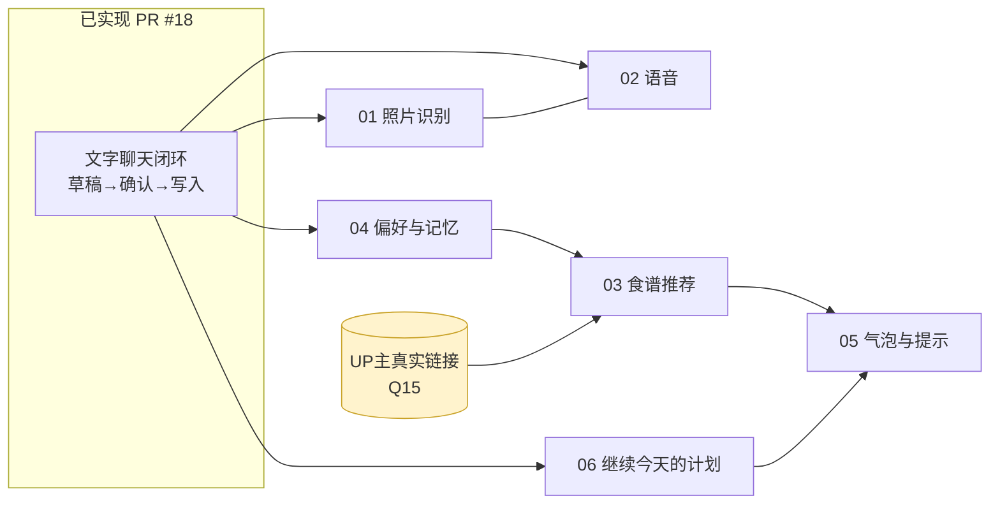

# 小爪后续功能提案包（草案，待一起评审）

状态：**草案 / 未评审 / 未实现**。日期：2026-10-22。作者：Claude（过夜起草）。评审人：Sylvan。
这些是**建议**，不是已决定的事。每份都标了"需要你决定什么"。没有一行代码来自这些提案。

## 怎么读

| 顺序 | 文件 | 内容 | 状态依赖 |
|---|---|---|---|
| 1 | 本文 | 索引、依赖图、建议顺序、全局假设 | — |
| 2 | `07-ADR.md` | 8 条架构决策记录（含备选与取舍） | 先看，后面都引用 |
| 3 | `08-wireframes.md` | 所有新界面的线框与状态 | — |
| 4 | `09-data-model-and-api.md` | 新增表（ERD）、接口、状态机、事件 | — |
| 5 | `01-PRD-food-photo.md` | 照片识别 | Q13 |
| 6 | `02-PRD-voice-input.md` | 产品内语音 | Q14 |
| 7 | `03-PRD-recipes.md` | 食谱来源、推荐、收藏 | **Q15（缺链接）** |
| 8 | `04-PRD-preferences.md` | 偏好、忌口、过敏、记忆 | Q16 |
| 9 | `05-PRD-nudges.md` | 小爪气泡与站内提示 | 依赖 03 |
| 10 | `06-PRD-training-continuation.md` | "继续今天的计划" | Q20 |
| 11 | `10-rollout-and-experiments.md` | 上线闸门、观察指标、风险登记、里程碑 | — |

> 你说"12啊还是什么"，我没听清是哪一种文档。我按常见的产品/工程评审材料都补了：PRD、技术方案、ERD、时序图、状态机、线框、ADR、测试映射、风险登记、实验设计。缺哪种告诉我。

## 依赖图

- **PHOTO 与 VOICE 可以并行**，且最后会合并成"同一次输入"（照片＋语音）。
- **REC 被 Q15 阻塞**：没有真实链接就不能开始验收（Patch §0 明令不得用虚构链接）。可以先做导入器和卡片，但不能宣称完成。
- **PREF 是 REC 的前置**（硬限制要先于推荐生效），也值得单独先做，因为它独立有用（"我不吃香菜"）。

## 建议的实施顺序（及理由）

| 阶段 | 做什么 | 为什么在这个位置 | 退出条件 |
|---|---|---|---|
| 0 | 明早：真实模型评测 + 线上迁移决策（Q1–Q5） | 现有闭环没有真实模型证据，后面所有功能都叠在它上面 | `coach:eval` ≥ 约定通过率；p95 延迟已知 |
| 1 | 04 偏好与记忆（最小版） | 独立有用、风险低、是推荐的前置、顺便验证"长期记忆"的隐私流程 | 本人可查/改/删；硬限制不被软偏好覆盖 |
| 2 | 02 语音（转写回填文字） | 复用现有文字流水线，改动面最小；先证明"说一句"比"打字"省事 | 真机录音/取消/拒权可用；转写可编辑 |
| 3 | 01 照片识别 | 价值最大也最重：Storage、隐私、视觉模型、标注集都要到位 | 30 例标注集 ≥27 例达标；隐私文案与行为一致 |
| 4 | 06 继续今天的计划 | 只读 + 跳转，成本低；Patch 把它当训练分期的下一步 | 不写组记录；无匹配方案时保留原计划 |
| 5 | 03 食谱 + 05 气泡 | 依赖链接与偏好；气泡最后做，避免没有内容就打扰 | 真实来源接通；每日最多 1 个气泡 |

如果你只想先做一件：**04（偏好）或 02（语音）**。如果最在意产品差异化：**01（照片）**，但它需要最多外部条件。

## 全局假设（全部**未验证**，评审时优先核对）

| # | 假设 | 影响 | 怎么核实 |
|---|---|---|---|
| A1 | 默认模型 `gpt-5.6-luna` 或你选的聊天模型支持图片输入和严格结构化输出 | 01、03 | 一次带图的 `/responses` 调用 |
| A2 | OpenAI 提供音频转写接口且支持中文 | 02 | 官方文档 + 一次真实调用 |
| A3 | Supabase Storage 可建私有桶，支持带签名的直传 URL，RLS 可约束对象路径 | 01、02 | 控制台 + 小脚本 |
| A4 | Netlify 函数有请求体大小和执行时长限制（具体数值不知道） | 01、02 | 部署后实测；Q1 |
| A5 | iOS Safari 的文件选择会把 HEIC 转成 JPEG（`accept="image/*"`） | 01 | iPhone 真机 |
| A6 | `MediaRecorder` 在 iOS Safari ≥ 14.3 可用，输出 mp4/aac，Chrome 输出 webm/opus | 02 | 真机 |
| A7 | B 站公开视频页能取到标题/封面（og 元信息），字幕通常不可匿名获取 | 03 | 对你给的链接逐条实测；**条款合规需你判断** |
| A8 | 2–3 名内测用户足以暴露可用性问题，但不足以证明留存 | 10 | — |

## 不在这批提案里的

- 身体进度照片分析（Patch §0：独立功能，本次不扩展）。
- 训练处方自动修改、聊天代点完成某组（HANDOFF 硬约束 4、6）。
- 多 Agent 框架（Patch §4）。
